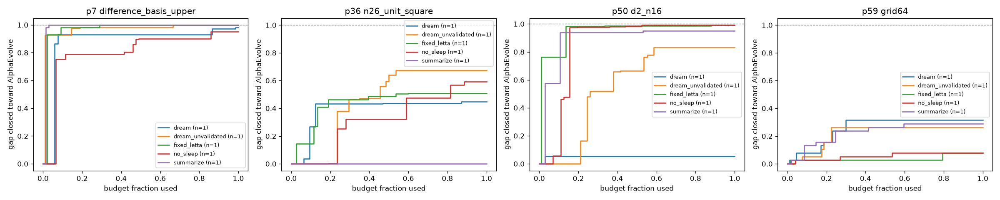
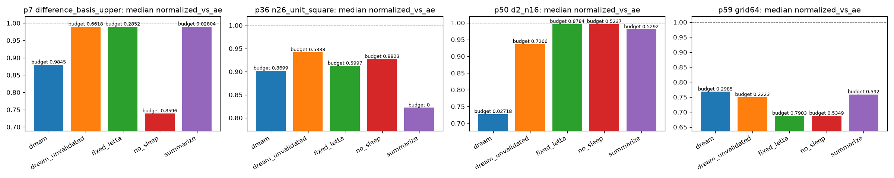

# AlphaEvolve benchmark report

> **Compute context.** AlphaEvolve ran with far larger compute and expert prompting; our runs use a small fixed token budget. AlphaEvolve's values are shown as a **reference ceiling, not a head-to-head comparison**. The head-to-head comparison is between our arms at matched budgets.

- git commit: `961f31a8c49cc7ecec014c12d64db24d7db44b52`
- registry: `benchmarks/alphaevolve.yaml` sha256 `faa97656349807f2` (retrieved 2026-11-14)
- models: gpt-5-nano
- token budgets (total per run): 250000
- runs: 20 found, 20 scored, 0 excluded

## Main table

One row per problem (and instance). Values are in the published units; per-arm cells are `median normalized_vs_ae / median gap_closed / matched+beat of n seeds`.

| problem | instance | status | evaluator | AlphaEvolve | prior best | current best | dream | dream_unvalidated | fixed_letta | no_sleep | summarize |
|---|---|---|---|---|---|---|---|---|---|---|---|
| 2. An autocorrelation problem related to Sidon sets | step_c1_upper | world_record | pending | 1.50316 | 1.50992 | 1.5029 | no runs | no runs | no runs | no runs | no runs |
| 3. How much can an autocorrelation of a non-negative function resemble an indicator function? | step_c2_lower_50000 | former_record | pending | 0.961021 | 0.88922 | — | no runs | no runs | no runs | no runs | no runs |
| 5. Erdős minimum overlap problem | step_h_upper | world_record | pending | 0.380923 | 0.380927 | 0.380876 | no runs | no runs | no runs | no runs | no runs |
| 7. Difference Bases | difference_basis_upper | world_record | verified | 2.63903 | 2.6571 | 2.63903 | 0.879676 / 0.9814 / 0+0 of 1 | 0.989635 / 0.99858 / 0+0 of 1 | 0.989635 / 0.99858 / 0+0 of 1 | 0.738928 / 0.95197 / 0+0 of 1 | 0.989635 / 0.99858 / 0+0 of 1 |
| 29. Block Stacking Problem | overhang_n2_49 | matched_optimal | pending | — | — | — | no runs | no runs | no runs | no runs | no runs |
| 34. Tammes problem | — | unlisted | pending | 8 instances | — | — | no runs | no runs | no runs | no runs | no runs |
| 36. Circle packing in a square / rectangle | n26_unit_square | former_record | verified | 2.63598 | 2.634 | 2.63598 | 0.90191 / 0.44906 / 0+0 of 1 | 0.941823 / 0.67324 / 0+0 of 1 | 0.912551 / 0.50883 / 0+0 of 1 | 0.927201 / 0.59111 / 0+0 of 1 | 0.821958 / 0 / 0+0 of 1 |
| 44. Sum-difference problem III | ruzsa_U_lower | former_record | pending | 1.1584 | 1.14465 | 1.17308 | no runs | no runs | no runs | no runs | no runs |
| 46. Minimal triangle density in graphs | graphon_area_len20 | matched_optimal | pending | — | — | — | no runs | no runs | no runs | no runs | no runs |
| 48. Heilbronn problem in a fixed bounding box | triangle_n11 | world_record | pending | 0.0365299 | 0.036 | 0.0365299 | no runs | no runs | no runs | no runs | no runs |
| 50. Max to min ratios | d2_n16 | world_record | verified | 12.8893 | 12.89 | 12.8893 | 0.727506 / 0.055364 / 0+0 of 1 | 0.936818 / 0.82991 / 0+0 of 1 | 0.996624 / 0.99146 / 0+0 of 1 | 0.996497 / 0.99113 / 0+0 of 1 | 0.980534 / 0.94993 / 0+0 of 1 |
| 59. Subsets of the grid with no isosceles triangles | grid64 | world_record | verified | 112 | 110 | 112 | 0.767857 / 0.31579 / 0+0 of 1 | 0.75 / 0.26316 / 0+0 of 1 | 0.6875 / 0.078947 / 0+0 of 1 | 0.6875 / 0.078947 / 0+0 of 1 | 0.758929 / 0.28947 / 0+0 of 1 |
| 62. The moving sofa problem | classic_sofa | matched_optimal | pending | 2.21927 | 2.2195 | 2.2195 | no runs | no runs | no runs | no runs | no runs |

`—` = missing in the sources (see the registry's missing_note) or no runs. gap_closed is null when the seed already meets the reference (nothing to close).

## By status category

Expectation: `matched_optimal` problems should be reachable; `world_record` problems are hard.

| status | problems | scored runs | median normalized_vs_ae | matched | beat (verified) |
|---|---|---|---|---|---|
| matched_optimal | 29, 46, 62 | 0 | — | 0 | 0 (0) |
| former_record | 3, 36, 44 | 5 | 0.912551 | 0 | 0 (0) |
| worse_than_record | — | 0 | — | 0 | 0 (0) |
| world_record | 2, 5, 7, 48, 50, 59 | 15 | 0.879676 | 0 | 0 (0) |
| unlisted | 34 | 0 | — | 0 | 0 (0) |

## Head-to-head between arms (matched budgets)

### Problem 7 (Difference Bases), instance `difference_basis_upper`

| arm | n | median normalized_vs_ae | median gap_closed | matched | beat | reached 0.9 (median budget frac) | reached 0.95 (median budget frac) | reached 0.99 (median budget frac) | median budget frac at best |
|---|---|---|---|---|---|---|---|---|---|
| dream_unvalidated | 1 | 0.989635 | 0.99858 | 0 | 0 | 1/1 (0.6618) | 1/1 (0.6618) | 0/1 (—) | 0.6618 |
| fixed_letta | 1 | 0.989635 | 0.99858 | 0 | 0 | 1/1 (0.28523) | 1/1 (0.28523) | 0/1 (—) | 0.28523 |
| summarize | 1 | 0.989635 | 0.99858 | 0 | 0 | 1/1 (0.028044) | 1/1 (0.028044) | 0/1 (—) | 0.028044 |
| dream | 1 | 0.879676 | 0.9814 | 0 | 0 | 0/1 (—) | 0/1 (—) | 0/1 (—) | 0.9845 |
| no_sleep | 1 | 0.738928 | 0.95197 | 0 | 0 | 0/1 (—) | 0/1 (—) | 0/1 (—) | 0.85964 |

### Problem 36 (Circle packing in a square / rectangle), instance `n26_unit_square`

| arm | n | median normalized_vs_ae | median gap_closed | matched | beat | reached 0.9 (median budget frac) | reached 0.95 (median budget frac) | reached 0.99 (median budget frac) | median budget frac at best |
|---|---|---|---|---|---|---|---|---|---|
| dream_unvalidated | 1 | 0.941823 | 0.67324 | 0 | 0 | 1/1 (0.29408) | 0/1 (—) | 0/1 (—) | 0.53385 |
| no_sleep | 1 | 0.927201 | 0.59111 | 0 | 0 | 1/1 (0.58853) | 0/1 (—) | 0/1 (—) | 0.88235 |
| fixed_letta | 1 | 0.912551 | 0.50883 | 0 | 0 | 1/1 (0.18758) | 0/1 (—) | 0/1 (—) | 0.59966 |
| dream | 1 | 0.90191 | 0.44906 | 0 | 0 | 1/1 (0.86989) | 0/1 (—) | 0/1 (—) | 0.86989 |
| summarize | 1 | 0.821958 | 0 | 0 | 0 | 0/1 (—) | 0/1 (—) | 0/1 (—) | 0 |

Third-party references (same instance; published values, labeled third_party):

| system | value | evaluations / cost | dream: median normalized | dream_unvalidated: median normalized | fixed_letta: median normalized | no_sleep: median normalized | summarize: median normalized | source |
|---|---|---|---|---|---|---|---|---|
| OpenEvolve | 2.63597739475 | 450 iterations (100 phase_1 + 100 phase_2 + 250 phase_2), best found at iteration 206 | 0.901912 | 0.941825 | 0.912553 | 0.927203 | 0.82196 | https://github.com/algorithmicsuperintelligence/openevolve/issues/156 ; examples/circle_packing/README.md 'Results' |
| OpenEvolve (community run, A. Deza) | 2.635983 | 100 phase_1 + 100 phase_2 iterations (Gemini models) | 0.90191 | 0.941823 | 0.912551 | 0.927201 | 0.821958 | https://github.com/algorithmicsuperintelligence/openevolve/issues/156 (comment by ArnaudDeza, 2025-08-05); paper reference [94] |
| ShinkaEvolve | 2.63598283901 | fewer than 150 program evaluations (paper Fig. 5) | 0.90191 | 0.941823 | 0.912551 | 0.927201 | 0.821958 | https://arxiv.org/abs/2509.19349 (v1) Section 4.1 and Appendix B.1 |
| GEPA optimize_anything | 2.63598 | max_metric_calls=150, reflection_lm openai/gpt-5 (appendix B config) | 0.901911 | 0.941824 | 0.912552 | 0.927202 | 0.821959 | https://github.com/gepa-ai/gepa/blob/main/docs/docs/blog/posts/2026-02-18-introducing-optimize-anything/index.md (section 6) and appendix/appendix-b-circle-packing.snippet |
| FICO Xpress (T. Berthold) | missing | — | — | — | — | — | — | https://www.fico.com/blogs/best-global-optimization-solver (cited by problems/36.html and paper [25]) |

### Problem 50 (Max to min ratios), instance `d2_n16`

| arm | n | median normalized_vs_ae | median gap_closed | matched | beat | reached 0.9 (median budget frac) | reached 0.95 (median budget frac) | reached 0.99 (median budget frac) | median budget frac at best |
|---|---|---|---|---|---|---|---|---|---|
| fixed_letta | 1 | 0.996624 | 0.99146 | 0 | 0 | 1/1 (0.009252) | 1/1 (0.13472) | 1/1 (0.13472) | 0.87838 |
| no_sleep | 1 | 0.996497 | 0.99113 | 0 | 0 | 1/1 (0.15321) | 1/1 (0.15321) | 1/1 (0.19438) | 0.52367 |
| summarize | 1 | 0.980534 | 0.94993 | 0 | 0 | 1/1 (0.10084) | 1/1 (0.10084) | 0/1 (—) | 0.52919 |
| dream_unvalidated | 1 | 0.936818 | 0.82991 | 0 | 0 | 1/1 (0.53413) | 0/1 (—) | 0/1 (—) | 0.72665 |
| dream | 1 | 0.727506 | 0.055364 | 0 | 0 | 0/1 (—) | 0/1 (—) | 0/1 (—) | 0.027176 |

Third-party references (same instance; published values, labeled third_party):

| system | value | evaluations / cost | dream: median normalized | dream_unvalidated: median normalized | fixed_letta: median normalized | no_sleep: median normalized | summarize: median normalized | source |
|---|---|---|---|---|---|---|---|---|
| OpenEvolve | missing | — | — | — | — | — | — | https://github.com/algorithmicsuperintelligence/openevolve/tree/main/examples/alphaevolve_math_problems/minimizing_max_min_dist/2 |
| ShinkaEvolve | missing | — | — | — | — | — | — | https://github.com/SakanaAI/ShinkaEvolve; arXiv:2509.19349v1 |
| GEPA optimize_anything | missing | — | — | — | — | — | — | gepa-ai/gepa optimize_anything blog post (2026-02-18) |

### Problem 59 (Subsets of the grid with no isosceles triangles), instance `grid64`

| arm | n | median normalized_vs_ae | median gap_closed | matched | beat | reached 0.9 (median budget frac) | reached 0.95 (median budget frac) | reached 0.99 (median budget frac) | median budget frac at best |
|---|---|---|---|---|---|---|---|---|---|
| dream | 1 | 0.767857 | 0.31579 | 0 | 0 | 0/1 (—) | 0/1 (—) | 0/1 (—) | 0.29855 |
| summarize | 1 | 0.758929 | 0.28947 | 0 | 0 | 0/1 (—) | 0/1 (—) | 0/1 (—) | 0.59198 |
| dream_unvalidated | 1 | 0.75 | 0.26316 | 0 | 0 | 0/1 (—) | 0/1 (—) | 0/1 (—) | 0.22226 |
| fixed_letta | 1 | 0.6875 | 0.078947 | 0 | 0 | 0/1 (—) | 0/1 (—) | 0/1 (—) | 0.79029 |
| no_sleep | 1 | 0.6875 | 0.078947 | 0 | 0 | 0/1 (—) | 0/1 (—) | 0/1 (—) | 0.53491 |

## Claims of beating AlphaEvolve

None.

## Excluded runs (never compared)

None.

## Registry coverage

| problem | tier | status | evaluator | instances | missing values |
|---|---|---|---|---|---|
| 2 | 1 | world_record | pending | step_c1_upper | — |
| 3 | 1 | former_record | pending | step_c2_lower_50000 | step_c2_lower_50000.current_best_value |
| 5 | 1 | world_record | pending | step_h_upper | — |
| 7 | 1 | world_record | evaluators.p7_difference_bases:DifferenceBasis | difference_basis_upper | — |
| 29 | 2 | matched_optimal | pending | overhang_n2_49 | overhang_n2_49.alphaevolve_value, overhang_n2_49.prior_best_value, overhang_n2_49.current_best_value |
| 34 | 1 | unlisted | pending | N3, N7, N12, N25, N32, N50, N100, N200 | — |
| 36 | 1 | former_record | evaluators.p36_circle_packing:CirclePacking26 | n26_unit_square, n32_unit_square, n21_rect_perimeter4 | — |
| 44 | 1 | former_record | pending | ruzsa_U_lower | — |
| 46 | 2 | matched_optimal | pending | graphon_area_len20 | graphon_area_len20.alphaevolve_value, graphon_area_len20.prior_best_value, graphon_area_len20.current_best_value |
| 48 | 1 | world_record | pending | triangle_n11 | — |
| 50 | 1 | world_record | evaluators.p50_max_min_ratio:MaxMinRatio16 | d2_n16, d3_n14 | d3_n14.current_best_value |
| 59 | 1 | world_record | evaluators.p59_no_isosceles:NoIsoscelesGrid64 | grid64, grid100 | — |
| 62 | 2 | matched_optimal | pending | classic_sofa | — |

## Figures

